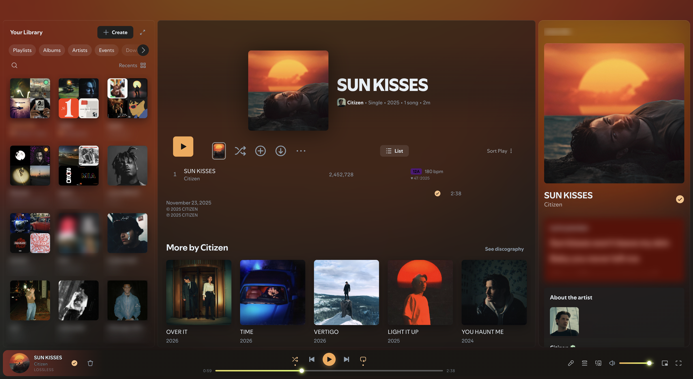

# Spicetify Extensions

Spicetify extensions I wrote for my own Spotify, plus the scripts I use to keep them running. I use the Comfy theme, and after a Spotify update broke part of its layout I started fixing it with my own CSS, then kept adding things I wanted. I've only tested it on macOS with Spotify 1.3.3.264 and 1.3.4.258 and Spicetify 2.45.1, and Spotify renames its classes often enough that other versions may break some of it.



## What's in it

`comfy-tweaks.js` fixes Comfy on current Spotify. Comfy sets three grid rows on the main container but Spotify now has four, and without the fix the main view collapses to 0 px. It also slows Comfy's window-size check from every frame to every 2 seconds. It assumes you have the Dynamic Search Bar snippet from Marketplace turned on, because it makes up for the 16 px that snippet shifts the page by. Without the snippet I'd expect the bottom 16 px of the window to get cut off.

`album-ambience.js` tints the theme with colors from the current album cover and puts a blurred copy of the cover behind the whole window. The cover in the now playing bar turns into a spinning disc, and the play button pulses on the beats from Spotify's audio analysis. Both stop when Reduce Motion is on in macOS. The animations use stepped timing, because a smooth animation makes Chromium redraw the whole window on every frame. On my Mac the smooth disc cost about 50% of a core and the stepped one about 13%.

`folder-images.js` gives playlist folders in Your Library a 2x2 grid of covers from the playlists inside them. You can right-click a folder and pick "Choose folder image" to use your own picture instead.

`library-hider.js` adds "Hide from library" to the right-click menu for DJ and Local Files, and a "Show" item to bring them back.

`library-moods.js` puts a colored dot on each playlist in Your Library for its mood (Hype, Intense, Chill or Moody), from the average energy and valence of its first 100 tracks. It also fades out anything you haven't played or added in 90 days.

`schemes/comfy-extra-schemes.json` has eight extra Comfy color schemes I made. It's in the shape Marketplace stores a theme's schemes in, keyed by scheme name. To use them with a copy of Comfy you installed by hand, each one becomes a `[Name]` section of `key = value` lines in Comfy's `color.ini`.

## Installing it

You need macOS, the Spotify desktop app from spotify.com, and Spicetify with Marketplace. `comfy-tweaks.js` also needs the Comfy theme and the Dynamic Search Bar snippet, both from Marketplace. The scripts in `tools/` that talk to the running app need Node 22 or newer.

If you don't have Spicetify yet, the official installer is below. Say yes when it asks about Marketplace. Its installer applies Spicetify once, and Spotify restarts with Marketplace in the sidebar. If it doesn't show up, run `spicetify backup apply`. There's more in the [Spicetify docs](https://spicetify.app/docs/getting-started).

```bash
curl -fsSL https://raw.githubusercontent.com/spicetify/cli/main/install.sh | sh
```

In Marketplace, install the Comfy theme, and turn on Dynamic Search Bar under Snippets.

Then clone this repo and run the installer from its folder:

```bash
./install.sh
```

It symlinks the five extensions into Spicetify's `Extensions` folder, adds them to the `extensions` line of `config-xpui.ini` and runs `spicetify apply`, which restarts Spotify. It finds the config folder through `spicetify` itself, so it needs `spicetify` on your PATH. Because they're symlinks, a `git pull` followed by `spicetify apply` is enough to update. Use `--copy` if you'd rather have copies, and `--no-apply` to skip the apply. Running it again doesn't add anything twice. `config-xpui.example.ini` shows what my config looks like with only these extensions in it.

To remove everything it added:

```bash
./uninstall.sh
```

## Keeping it applied after Spotify updates

Every Spotify update replaces the app files, which removes Spicetify. `tools/autoheal.sh` checks for that and runs `spicetify backup apply` again when it's needed. To have it run on its own:

```bash
./install.sh --autoheal
```

That fills in `tools/autoheal.plist.template` and loads it as the LaunchAgent `local.spicetify-autoheal` (set `AUTOHEAL_LABEL` to use a different label). It runs the script at login, every 30 minutes, and whenever the Spotify app changes. It points at this folder, so run it again if you move the repo. `./uninstall.sh` removes it.

A run where everything is fine writes one line to `tools/autoheal.log` and exits. Otherwise it waits until the Spotify bundle stops changing, makes sure Spotify's prefs have the new version (opening Spotify once in the background if they don't), applies, and restarts Spotify if it was running before. It gives up after 3 failed attempts on the same Spotify version and shows a notification. Delete `tools/autoheal.state` to let it try again.

Every run also patches a version check in Spicetify 2.45.1's `spicetifyWrapper.js`. That check runs a scroll optimizer on Spotify 1.3.x by mistake, which cost me about 8% of a core while Spotify sat idle. The fix is already upstream but not in a release yet.

If there's a `tools/autoheal.local.sh` next to the script, it gets sourced first and can redefine any of these functions:

- `local_is_healthy` adds its own check to the healthy test
- `local_describe_health` adds text to the log line for an unhealthy run
- `local_needs_stock_client` says whether the repair has to start from Spotify's stock files
- `local_patch_stock_client` runs on the stock files before Spicetify applies
- `local_after_apply` runs after Spicetify applies

I use it for a patch of my own. It's gitignored, and without it the script only deals with Spicetify.

You can run the script by hand with `bash tools/autoheal.sh` and check `tail tools/autoheal.log`. It finds Spicetify on your PATH or in `~/.spicetify`, and reads the Spotify path from `config-xpui.ini`.

## Testing it in the running app

```bash
sh tools/debug-spotify.sh
node tools/cdp.mjs "document.title"
node tools/shot.mjs out.png
```

`debug-spotify.sh` quits Spotify and opens it again with the DevTools port on 9222, so it stops whatever is playing. `cdp.mjs` runs an expression in the page (or a file, with `-f file.js`) and prints the result. `shot.mjs` saves a screenshot at the window's full resolution, and a second argument clips it to that many pixels from the top. After editing an extension, `spicetify refresh -e` and then `node tools/cdp.mjs "location.reload()"` load the change without a full apply.

## A note on Spotify's terms

Client mods like these are a gray area under Spotify's terms of use. This is my personal setup on my own account, so use it knowing that.

## Credits

Everything here runs on [Spicetify](https://github.com/spicetify/cli) and [Marketplace](https://github.com/spicetify/marketplace), and the theme is [Comfy](https://github.com/Comfy-Themes/Spicetify). I also run these extensions by other people, and a couple of them show up in the screenshot:

- [Sort-Play](https://github.com/hoeci/sort-play) by hoeci
- [DJ Info](https://github.com/L3-N0X/spicetify-dj-info) by L3-N0X
- [Playlist Icons](https://github.com/jeroentvb/spicetify-playlist-icons) by jeroentvb
- [Hide Podcasts](https://github.com/theRealPadster/spicetify-hide-podcasts) by theRealPadster
- [Cover Ambience](https://github.com/Theblockbuster1/spicetify-extensions/tree/main/CoverAmbience) by Theblockbuster1
- Trash Bin, which comes with Spicetify

## License

MIT, see [LICENSE](LICENSE).
